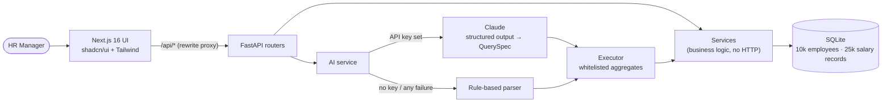
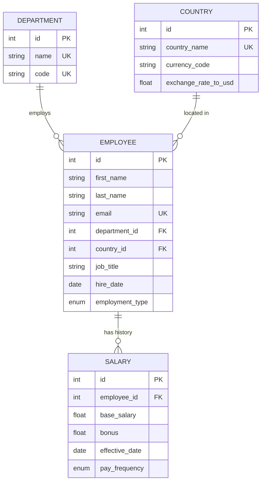
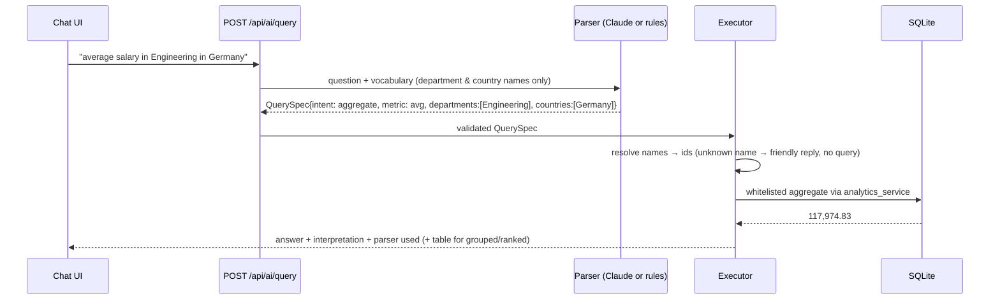

# Architecture

## System overview



The browser talks to one origin; Next.js forwards `/api/*` to FastAPI, so there is no CORS setup in development and the backend URL is a single config value (`BACKEND_URL`).

## Data model



- `base_salary` is **per pay period** in local currency (`ANNUAL`, `MONTHLY`, `BIWEEKLY`); `bonus` is annual.
- **Current salary** = the record with the latest `effective_date <= today` (ties → highest id). It is *derived*, never stored, so it cannot drift from the history. Future-dated records are scheduled raises.
- Annual USD = `base_salary × periods_per_year × exchange_rate_to_usd`, rounded to cents **in SQL** so that range filters and sorting behave exactly.
- Deleting an employee cascades to their salary records (ORM cascade + `ON DELETE CASCADE`, foreign keys enforced in SQLite via `PRAGMA foreign_keys=ON`).

Indexes: `employees.department_id`, `employees.country_id`, `employees.employment_type`, `(last_name, first_name)`, unique `email`, and `salaries(employee_id, effective_date)`.

## Backend layering

```
backend/app/
  routers/     HTTP only: parse & validate query/body, call a service, return a schema
  schemas/     Pydantic models — the API contract
  services/    business logic; raises DomainError subclasses (NotFound → 404, Conflict → 409, Unprocessable → 422)
    compensation.py      the one place "current salary in annual USD" is defined
    filters.py           EmployeeFilters — shared by the list, the dashboard and the AI executor
    employee_service.py  list (paginated/sorted/filtered), get, create, update, delete
    salary_service.py
    analytics_service.py aggregate / grouped / median / top_earners / summary
    ai/                  query_spec → rule_parser | llm_parser → executor → service (fallback chain)
  models/      SQLAlchemy 2 typed models
```

Design choices:

- **One definition of "current compensation."** `current_compensation_subquery()` is reused by the employee list, the detail view, every analytics function and the AI executor, so the dashboard, the table and the assistant can never disagree about what someone earns.
- **One filter object.** `EmployeeFilters` is built from query params for the list and dashboard, and from a `QuerySpec` for the AI. All three hit identical WHERE clauses.
- **Services don't know about HTTP.** They take a `Session` and plain values and raise domain errors; one exception handler maps them to status codes. That's what makes them unit-testable without a server.
- **Median in SQL.** SQLite has no `MEDIAN`, so it is computed with `ROW_NUMBER()`/`COUNT()` window functions (also per group), instead of pulling 10k values into Python.

## The AI assistant



Why a **QuerySpec instead of text-to-SQL**:

1. **Safety** — no generated SQL is ever executed, so there is nothing to inject and no way to write data. The model only sees department and country *names*, never salaries or people.
2. **Correctness** — the executor reuses the same tested analytics functions as the dashboard, so an AI answer matches the dashboard to the cent.
3. **Testability** — parsers are tested by asserting on the spec; execution is tested separately; the LLM is replaced by a fake in tests.
4. **Graceful degradation** — the rule parser produces the same spec, so the feature works offline, in CI and when the LLM call fails. The UI shows which parser answered and how the question was interpreted.

Fallback chain (`services/ai/service.py`): LLM configured? → try LLM → if it raises, times out, returns an invalid spec or says *unsupported* → rule parser → executor. Every branch is covered by `tests/test_ai.py`.

## Frontend structure

```
frontend/
  app/                 routes: / · /employees · /employees/[id] · /assistant
  components/
    ui/                shadcn/ui primitives (generated, Radix-based)
    common/            app-level building blocks: ConfirmDialog, ErrorBanner, FormField, OptionSelect, theme
    dashboard/         MetricCard, BreakdownChart, DashboardView
    employees/         table, filter drawer, pagination, forms, salary history, detail view
    ai/                chat panel, answer table
  lib/                 typed API client (ApiError with server messages), types mirroring the API, formatters, hooks
```

- Data fetching is client-side with `AbortController`, so fast typing or quick filter changes never render stale results; free-text inputs are debounced (300 ms).
- Errors from FastAPI (`detail` string or 422 validation list) are turned into readable messages by one function in `lib/api.ts` and surfaced as inline form errors, retryable banners, or toasts.
- Charts follow a single-series, direct-labelled design (no legend needed), with a hover tooltip and colours validated for contrast in light and dark themes.

## Key decisions & trade-offs

| Decision | Alternative considered | Why |
|---|---|---|
| FastAPI + Next.js | Spring Boot + Angular (the role's preferred stack) | The brief allows any stack; chosen for delivery speed, with the same layering a Spring app would have (router ≈ controller, service, schema ≈ DTO, model ≈ entity). |
| SQLite | Postgres | Zero setup for reviewers; ORM keeps migration small (median uses SQLite integer-division semantics — noted). |
| Salary history + derived current | `current_salary` column on employee | No drift, supports scheduled raises and "what was X paid in 2023". Cost: a window-function subquery on reads (measured below 60 ms). |
| Floats rounded to cents in SQL | Integer minor units / `NUMERIC` | Simpler for SQLite and the demo; production should use integer minor units. |
| QuerySpec + rule fallback | LLM text-to-SQL | Safety, consistency with the dashboard, offline operation, testability. |
| Client-side fetching | React Server Components fetching | Interactive filters/sorting with cancellation; the data is per-user and uncacheable anyway. |
| shadcn/ui | MUI / Chakra | Components are copied into the repo (no runtime theme layer), accessible Radix primitives, Tailwind-native. |
